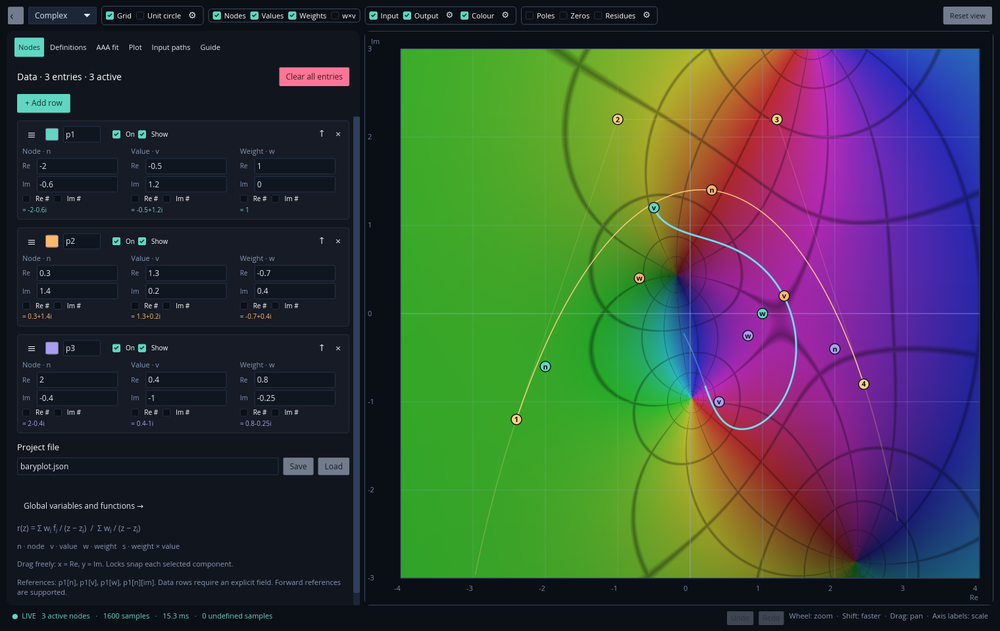

# Baryplot

An interactive workbench for barycentric rational functions, built with Rust and
[iced](https://github.com/iced-rs/iced). Construct functions by hand, fit them with
AAA, and explore their behaviour in the real or complex plane.

[User guide](docs/guide.md) · [Examples](examples) · [MIT license](LICENSE)



## Features

- **Live editing** — drag nodes, values and weights independently, or enter
  mathematical expressions. Integer locks snap individual components.
- **Real and complex modes** — plot real functions, map complex input curves and
  explore phase and magnitude with configurable domain colouring.
- **AAA fitting** — adaptive function sampling with classic AAA or NL-AAA,
  optional Lawson refinement and cleanup, convergence results and cancellation.
- **Reusable definitions** — global variables, expression functions and multiline
  numeric functions with local variables, conditions and bounded loops.
- **Multiple input paths** — intervals, points, polylines, Bézier curves, splines
  and NURBS, each with its own sampling settings.
- **Interactive analysis** — poles, zeros and residues, configurable grids and
  axes, a unit-circle guide, palettes and contours.
- **Project workflow** — undo/redo, draggable settings dialogs, reorderable data
  rows and JSON project files.

Manual edits update the plot continuously. Function fitting is an explicit action
and runs in a cancellable background process.

## Build and run

Install a current stable [Rust toolchain](https://rustup.rs/), then run these
commands from the repository directory:

```sh
cargo run --release
```

Start with complex parameters, or open an example project:

```sh
cargo run --release -- --complex
cargo run --release -- --project examples/numeric-functions.json
```

To build the executable without launching it:

```sh
cargo build --release
./target/release/baryplot
```

Linux is the currently tested platform. The application uses wgpu and needs a
working graphics driver. `Cargo.lock` pins the dependencies, including iced's
Git revision. No MATLAB or Python runtime is needed.

## A quick tour

1. In **Nodes**, edit each row's node, value and weight. Drag its coloured markers
   on the plot to explore changes directly.
2. Add shared variables or functions in **Definitions**. Expressions work in
   parameter fields and most numerical settings.
3. In **AAA fit**, choose a one-argument function, set its interval and press
   **Run fit**. Preview the result or copy it into editable rows.
4. Use **Input paths** to choose where the function is evaluated. The toolbar
   controls marker visibility, input/output lines, colouring and spectral views.

| Action | Control |
| --- | --- |
| Pan | Drag empty plot space; middle-drag also works over handles |
| Zoom | Mouse wheel; hold Shift for faster zoom |
| Scale one axis | Drag its tick-label gutter |
| Move a parameter | Drag its `n`, `v` or `w` marker |
| Reorder rows | Drag the row grip; hold near a list edge to scroll |
| Undo / redo | Ctrl+Z / Ctrl+Shift+Z or Ctrl+Y |
| Move between fields | Tab / Shift+Tab |
| Expand the plot | Collapse the editor with the toolbar's leftmost button |

See the [user guide](docs/guide.md) for expressions, numeric functions, fitting
options, input paths, display settings and numerical limitations.

## Development

```sh
cargo fmt --all -- --check
cargo clippy --all-targets -- -D warnings
cargo test
```

Release builds are optimized and stripped. Use `cargo build --profile profiling`
for an optimized build with debug information and symbols.

## License

Baryplot is licensed under the [MIT license](LICENSE). Dependencies retain their
respective licenses. Numerical references are listed in the [guide](docs/guide.md#references).
