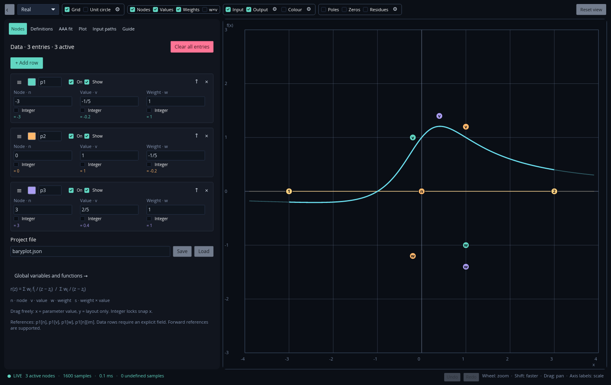
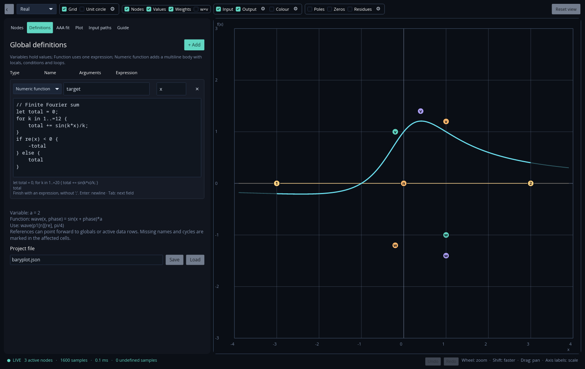

# Baryplot user guide

[Back to the README](../README.md)

- [Working with barycentric data](#working-with-barycentric-data)
- [Definitions and expressions](#definitions-and-expressions)
- [Multiline numeric functions](#multiline-numeric-functions)
- [Fitting a function](#fitting-a-function)
- [Input paths](#input-paths)
- [Plot appearance](#plot-appearance)
- [Poles, zeros and residues](#poles-zeros-and-residues)
- [Saving projects](#saving-projects)
- [Numerical behaviour](#numerical-behaviour)
- [Building and testing](#building-and-testing)
- [References](#references)

## Working with barycentric data

Every enabled row defines a support node `z`, function value `f` and weight `w`.
Together they specify the rational function

```text
       Σⱼ wⱼ fⱼ / (z − zⱼ)
r(z) = ────────────────────
         Σⱼ wⱼ / (z − zⱼ)
```

The **Nodes** tab lets you add, remove, name, colour and reorder rows. **On**
controls whether a row contributes to the function; **Show** controls its markers.
The toolbar has master visibility controls for all nodes, values and weights.
The optional `s` marker shows the derived product `w × f` and cannot be edited.

In **real mode**, dragging a marker changes its numerical value along x. Its y
position is saved only as a convenient layout position. In **complex mode**, x
and y are the real and imaginary components. Each parameter moves independently.
Integer locks round evaluated components and snap dragged markers. Complex mode
has separate locks for real and imaginary parts.

Markers stay at their exact coordinates, even when they overlap. Hover a row to
highlight its markers and raise them for selection. The highlight disappears on
exit, while the last hovered set remains in front. The row's **↑** button can
optionally pin its set in front.

Drag the row grip to reorder the table. A translucent preview follows the
pointer, other rows make space, and a rounded indicator shows the insertion
position. Hold near the visible list's top or bottom to scroll automatically.
The add-row control stays visible above the list. **Clear all entries** removes
the table; undo restores it.

Manual edits update continuously. If a formula becomes invalid while typing,
warning indicators identify the affected fields. Last-valid colours and marker
positions remain available until the input is valid again.



## Definitions and expressions

Most numerical fields accept expressions: parameter components, axis limits,
input-path coordinates, sampling settings and fitting options. Multiplication is
explicit except for imaginary literals such as `3i`.

The **Definitions** table has three types:

| Type | Meaning | Example |
| --- | --- | --- |
| Variable | A shared numerical expression | `scale = 2` |
| Function | A reusable expression with arguments | `wave(x, phase) = scale*sin(x+phase)` |
| Numeric function | A multiline body with local state and control flow | See below |

Enter the name, arguments and expression/body in their separate fields. Functions
accept real or complex arguments and may call other defined functions. Forward
references work across definitions and active data rows; circular dependencies
are errors. Variables are reevaluated when their dependencies change.

Named data rows expose explicit fields:

| Reference | Meaning |
| --- | --- |
| `p1[n]` | Node |
| `p1[v]` | Value |
| `p1[w]` | Weight |
| `p1[wv]` or `p1[s]` | Weight × value |
| `p1[n][re]`, `p1[n][im]` | Real or imaginary component |

The names `node`, `value`, `weight`, `real` and `imag` are also accepted. Numeric
selectors `[0]` through `[3]` select node, value, weight and weighted value.
Dot notation such as `p1.node` and `p1.value` is supported. A bare row name such
as `p1` is not a scalar; select its field. References use evaluated, integer-snapped
values. Disabled rows do not supply variables, and renaming a row requires
updating references to it.

Names must be unique ASCII identifiers. Constants, built-in function names and
language keywords are reserved. Constants include `pi`, `tau`, `e`, `phi`, `i`,
`true` and `false`.

### Operators and built-in functions

Arithmetic operators are `+ - * / % ^`, with parentheses for grouping. Powers
associate right to left; `-2^2` is `-4`. `%` has multiplication precedence and is
the real remainder: `-5 % 3 = -2`. `mod(-5,3)` is `1`; all remainder operations
require real operands and a nonzero divisor.

| Group | Functions |
| --- | --- |
| Trigonometric | `sin cos tan asin acos atan sec csc cot` |
| Hyperbolic | `sinh cosh tanh asinh acosh atanh sech csch coth` |
| Powers and logarithms | `sqrt cbrt square pow exp exp2 exp10 expm1 ln log log2 log10 log1p` |
| Complex values | `complex polar cis re im real imag conj abs norm abs2 norm_sqr arg sign signum` |
| Numeric utilities | `floor ceil round trunc fract sinc lerp` |
| Real arguments | `min max clamp hypot atan2 mod rem radians degrees` |

Angles use radians; `log` is the natural logarithm. `complex(re,im)` constructs a
complex value, `polar(radius,angle)` uses polar coordinates, and `cis(z)=exp(i*z)`.
`abs2` and `norm_sqr` give squared magnitude. `sinc(z)=sin(z)/z`, with `sinc(0)=1`.
Rounding functions act on each component. `cbrt` gives the real cube root for real
arguments and the principal cube root otherwise.

Functions with two arguments include `pow`, `complex`, `polar`, `min`, `max`,
`hypot`, `atan2`, `mod` and `rem`. `clamp(x,min,max)` and `lerp(a,b,t)` take three.
User-defined functions accept up to sixteen arguments.

Complex parameter boxes edit Re and Im separately; each box expects a real
result. For a complex definition `c`, use `re(c)` or `im(c)` in those boxes.
Switching to real mode ignores saved imaginary components and preserves them for
switching back. If the projection creates duplicate nodes, move them apart.

Try [the definitions example](../examples/definitions.json).

## Multiline numeric functions

Choose **Numeric function** in Definitions, set a name and arguments, and enter
a body. For a function named `series` with argument `x`:

```text
// A finite Fourier sum
let total = 0;
for k in 1..=20 {
    total += sin(k*x)/k;
}
if re(x) < 0 {
    -total
} else {
    total
}
```

Call it as `series(0.5)`, `series(p1[n])` or `series(0.5+i)`. Both function types
can call each other, and one-argument numeric functions appear in AAA fitting.

- `let name = expression;` declares a mutable local. Assign with `=`, `+=`, `-=`,
  `*=`, `/=` or `%=`. Arguments, globals, row fields and loop indices are read-only;
  copy an argument into a local before modifying it.
- End declarations and assignments with `;`. The **last expression, without a
  semicolon, is the result**. It can be an `if/else` expression. Outer braces
  around the whole body are optional; loop and branch bodies require braces.
- Nested blocks have lexical scope and can shadow outer locals. Assignments
  update the nearest local. Called functions do not capture caller locals.
- `for k in start..end` excludes the endpoint; `start..=end` includes it. Bounds
  are evaluated once, must be real integers with magnitude below `2^53`, and
  advance by one. Reversed ranges have no iterations; nested loops are allowed.
- Conditions use `== != < <= > >=`, `&&`, `||` and `!`. Equality accepts complex
  values; ordering requires real values. Use `re(z)`, `im(z)` or `abs(z)` as needed.
  Write `0<x && x<1`, rather than chaining comparisons.
- Conditions must be real: zero is false, any other finite real value is true.
  Boolean results and `true`/`false` are numerical 1/0. Arithmetic binds before
  comparisons, then `&&`, then `||`.
- Branches and boolean operators short-circuit. An `if` branch returns its last
  expression, or zero if it contains only statements; an omitted `else` also
  yields zero. `else if` is supported.
- `//` and `#` introduce line comments. Recursion, `while`, `return`, `break` and
  `continue` are not supported; the final expression supplies the return value.

Enter inserts a newline. Tab and Shift+Tab move between fields. Project undo/redo
includes body edits. Syntax and statement-evaluation errors report line/column
locations. All branches are checked for missing names, arity errors and recursive
calls, even when a branch is not evaluated.

Each evaluation has a shared 16,384-operation budget across loops and nested
function calls. A range also has a 10,000-iteration cap; the work budget can be
reached before that cap. Bodies are limited to 32 KiB, with bounded nesting.



Open [the numeric-function example](../examples/numeric-functions.json) for a
Taylor-series body that can be fitted with AAA or NL-AAA.

## Fitting a function

1. Create a **Function** or **Numeric function** in Definitions with one argument,
   for example `target(x) = exp(x)`.
2. Open **AAA fit** and select the function and method.
3. Set the interval and tolerance, then press **Run fit**.
4. Inspect the error summary and convergence table. **Show fit preview** switches
   between the result and manual data. **Use as editable nodes** copies the fit
   into the table for direct editing.

Each click performs one bounded run. **Cancel** stops active work; **Restart fit**
replaces it. Changing settings or definitions retains the last completed result
and waits for another click. Opening a saved project does not start a fit.

Fitting preserves the viewport and all input paths, including across mode
changes. **Frame fit interval** explicitly frames a completed result. Importing a
fit reports a conflict if doing so would remove row names used by definitions.

| Setting | Behaviour |
| --- | --- |
| Method | Classic AAA or NL-AAA with SK/Whitfield weight refinement |
| Interval | A real parameter interval; the target may return complex values in Complex mode |
| Relative tolerance | Max-error stopping tolerance, evaluated in f64; default `1e-13` |
| Max support nodes | Adaptive support budget, up to 256 |
| Fixed degree | Run to `N+1` support points without early tolerance stopping; cancellations can reduce algebraic degree |
| Minimum samples per gap | Local probe density: 3, 5, 9, 15 or 30 |
| Lawson steps | Optional refinement, 0–100 iterations |
| Lawson damping | 0–1; 1 is standard reweighting, smaller values temper updates, 0 keeps uniform row weights |
| Sign modification | A classic-AAA option for sign-like functions; hidden for NL-AAA |
| Cleanup | Remove negligible-residue doublets; available without fixed degree or Lawson |

Selecting fixed degree initially sets 20 Lawson steps for classic AAA; adjust
that count as desired. NL-AAA retains the chosen Lawson count. Lawson can change
the values at support nodes; the best observed sampled max-error result is kept.

The sampler starts with endpoints and inserts local probes between supports. It
uses more probes early and reuses cached function evaluations. Verification adds
denser and off-grid probes. A failed verification reports the measured error
without automatically restarting the fit or increasing budgets.

**NL-AAA** refines weights with Sanathanan–Koerner and Whitfield iterations.
Defaults are 20 iterations of each, with convergence tolerance `1e-4`; each budget
can be set from 1 to 100. Earlier probes remain as constraints. Failed refinement
retains the previous approximation, and stalled or zero-weight steps use a
relative-error greedy alternative.

NL-AAA minimizes sampled rational L2 error; the fit's stopping tolerance still
uses max error. The summary reports both. Fixed-data L2 monotonicity does not
imply monotonic max error on adaptive grids, or after optional Lawson/cleanup.
NL-AAA does more work per node and need not improve every function.

Try [real fitting](../examples/aaa-real.json),
[complex fitting](../examples/aaa-complex.json), or the
[multiline example](../examples/numeric-functions.json).

## Input paths

Input paths define where the displayed function is evaluated. Each path has a
name, enabled toggle, independently collapsible card, sample count and
extrapolation setting. Add paths with **+ Add path**, and remove them with **×**.
Selecting or editing a card selects its handles on the plot.

| Mode | Available paths |
| --- | --- |
| Real | Real interval or single point |
| Complex | Real interval, single point, polyline, Bézier, Catmull–Rom spline or NURBS |

A complex curve temporarily displays as an interval in real mode; its kind and
geometry are preserved for switching back. A point evaluates once. An interval
has draggable endpoints on the real axis. Curve points can be added with the
green **+ Add point** button or by clicking in draw mode, and removed with **×**
or right-click. **Clear all** empties that curve or point.

Samples are spaced linearly over the input interval or curve parameter. Curve
extrapolation extends `t∈[0,1]` by the chosen percentage at each end; 15% gives
`[-0.15,1.15]`. Extrapolated output is drawn more faintly. NURBS uses clamped
uniform knots and degree `min(3, points−1)` with positive editable weights, and
endpoint tangent extensions outside the base interval.

Input handles take priority while the Input paths tab is selected, including
when previewing a fit. Middle-drag still pans in draw mode. Path changes update
the input/output curves without recomputing domain colouring.

## Plot appearance

Use the toolbar toggles for grid, unit circle, parameters, input/output curves,
colouring and spectral markers. Gear buttons open draggable settings dialogs.
Colour swatches share an HSV/RGB picker; changes preview live, and Cancel/Escape
restores the previous colour. Collapse the editor for a wider plot.

- **Lines:** input/output colour, opacity, thickness, dashes and extrapolation
  visibility. Complex input paths can also show their control polygon.
- **Grid and axes:** independent major spacing, minor divisions, zero axes,
  border styles, tick density, number format and colours. Linear, Log10 and
  symmetric-log axes are available. The master Grid toggle also hides zero axes.
- **Unit circle:** colour, opacity, thickness, dashes and cardinal marks. A cached
  2048-segment guide follows the current projection.
- **Background and readout:** background colour, cursor-data visibility and
  cursor-data colour. Real-mode readouts include the cursor's x/y and `f(x)`.
- **Domain colouring:** palettes, phase origin, reversal, saturation, magnitude
  shading, brightness bands, phase/modulus contours and image opacity.

Scroll to zoom around the cursor; hold Shift for faster zoom. Drag an axis's
label gutter to scale that axis independently. The plot preserves its scale
proportions when hiding/restoring the editor.

Domain colouring also works in real mode: coefficients are treated as having
zero imaginary parts and the image evaluates `r(x+iy)`, while the real output
curve still follows `r(x)`. The colour domain can follow the viewport with
independent margins in percentages or axis units.

Image width is configurable from 1 to 16384, with half/double controls; the
default is 1024. Height follows domain proportions within dimension and memory
limits. **Restore original colouring** selects the phase wheel, magnitude
shading and repeating brightness bands with contours off. Turning contours off
alone does not remove brightness bands. Scientific palettes may have a phase
seam; cyclic palettes close the loop.

## Poles, zeros and residues

The toolbar group controls their visibility. Its gear opens computed lists,
real/complex location filters, pole-magnitude bounds and cleanup display filters.
Complex roots can appear in either mode, at `(Re,Im)`. **Frame poles/zeros** reveals
roots outside the viewport.

Calculations use generalized-eigenvalue pencils rather than explicit polynomial
coefficients. Infinite eigenvalues are excluded. Residues at repeated or very
closely clustered poles can be unavailable and are labelled accordingly.
Cleanup display filters hide flagged pole/zero candidates; they do not modify
the function. Cleanup methods follow the criteria discussed in Chebfun's AAA
implementation, including its pole-free-domain heuristic for real intervals.

Spectral work runs independently of plotting. Its **×** or **Cancel** stops work;
**Calculate all** or a display toggle resumes it. Disabling an output cancels
unneeded work. Last-completed data remains visible, and panning reuses available
results. Fits and spectral solves run in disposable child processes, allowing
cancellation even during a dense matrix factorization.

## Saving projects

Save and load JSON using the project controls in Nodes or Guide. Files preserve
rows, definitions, types and bodies, locks, colours, viewport, input paths and
sampling settings. Parameter and path expressions remain expressions; axis
limits are saved as evaluated coordinates. A completed fit is regenerated with
**Run fit**, rather than automatically computed on load.

Paths are relative to the working directory unless absolute. A saved project can
also be opened from the command line:

```sh
cargo run --release -- --project examples/complex.json
```

Tab/Shift+Tab visit fields in visual order; complex fields visit Re before Im.
Ctrl+Z undoes and Ctrl+Shift+Z or Ctrl+Y redoes (Command on macOS). Continuous
typing and dragging are grouped into edits. History is held in memory for the
session, bounded to 128 edits and about 32 MiB.

## Numerical behaviour

All evaluations use f64. Requested tolerance is not arbitrary precision or a
mathematical guarantee across every point of a continuum. Undefined samples and
large jumps near poles break the displayed line; extrapolation can be unstable.
Moving or fitting a small number of samples can hide features between them.

Line evaluation uses runtime SIMD dispatch with scalar fallbacks for exact
supports, near-pole cancellation and extreme magnitudes. Domain images use
parallel evaluation. Plot layers are cached, and asynchronous results are checked
against model/image generations so old work cannot replace current state.

Regression tests include real/complex identities, known rational fits,
independent evaluation points, numerical comparison fixtures, SIMD parity,
legacy projects, cancellation, UI focus, dragging and undo/redo. The comparison
fixtures are included; neither MATLAB nor external reference code is needed to
run them.

## Building and testing

The application uses Rust 2024, iced/wgpu, faer, Rayon and `fearless_simd`.
The lockfile pins dependency revisions. The test suite has been verified on
Linux x86-64 with stable Rust 1.99.1. From the repository root:

```sh
cargo fmt --all -- --check
cargo clippy --all-targets -- -D warnings
cargo test
cargo build --release
```

Shipping builds use optimization level 3, thin LTO and stripped symbols. For
source-level debugging at release speed:

```sh
cargo build --profile profiling
./target/profiling/baryplot
```

When building binaries for other machines, avoid machine-specific `target-cpu`
flags. To override locally configured Rust flags for a generic build:

```sh
CARGO_ENCODED_RUSTFLAGS="" cargo build --release
```

Runtime SIMD dispatch still selects supported instructions on each machine.

Optional headless screenshot checks use iced's software renderer:

```sh
cargo test render_readme_previews -- --ignored --nocapture
```

These documentation screenshots are written to `/tmp/baryplot-readme-previews`.
The other preview checks default to `/tmp/baryplot-previews`. The software
renderer is a development dependency; the app itself uses wgpu. A desktop is
not required for these checks. The on-screen Guide also summarizes controls.

## References

The numerical methods are implemented in Rust using faer. These publications
and mathematical references describe the algorithms; their MATLAB code is not
part of Baryplot's source or runtime:

- [Chebfun AAA](https://github.com/chebfun/chebfun/blob/master/aaa.m) — AAA,
  sign modification, Lawson refinement and cleanup criteria.
- [AAA rational approximation on a continuum](https://arxiv.org/abs/2305.03677) —
  adaptive local sampling.
- [A refined nonlinear least-squares method for the rational approximation
  problem](https://doi.org/10.1007/s40687-026-00668-1), Ackermann, Balicki,
  Gugercin and Werner (2026) — NL-AAA, SK/Whitfield refinement and adaptive
  initialization.

Baryplot is [MIT-licensed](../LICENSE); dependencies retain their own licenses.
